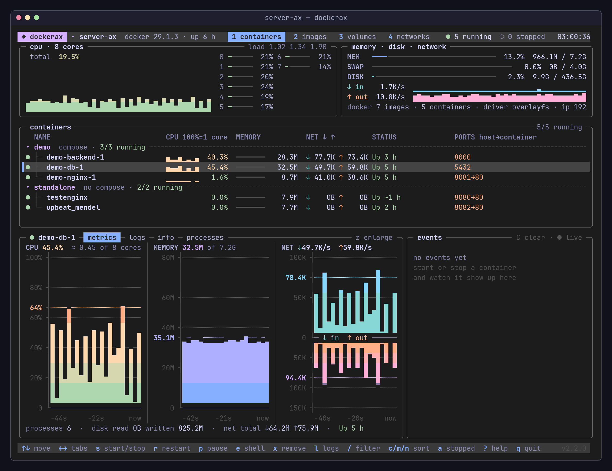
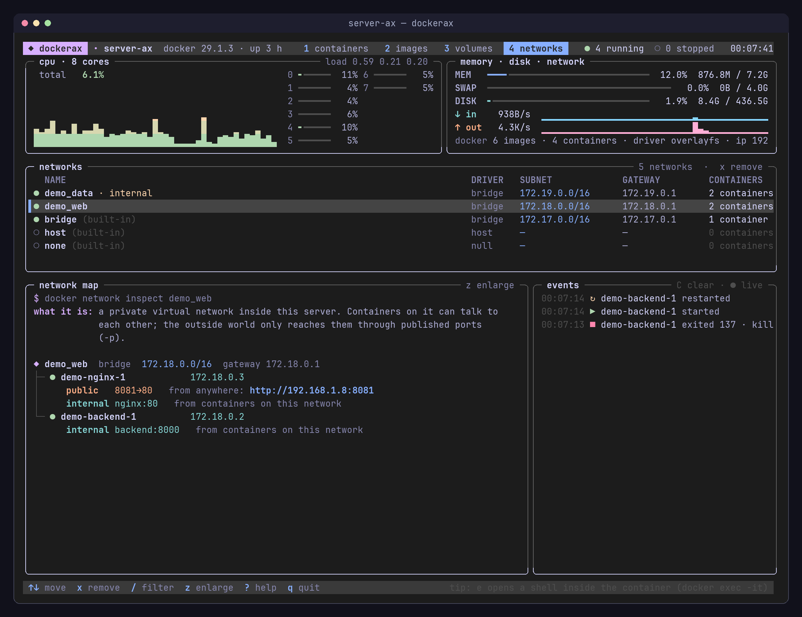
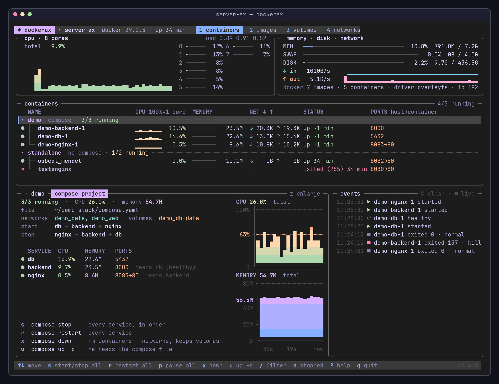
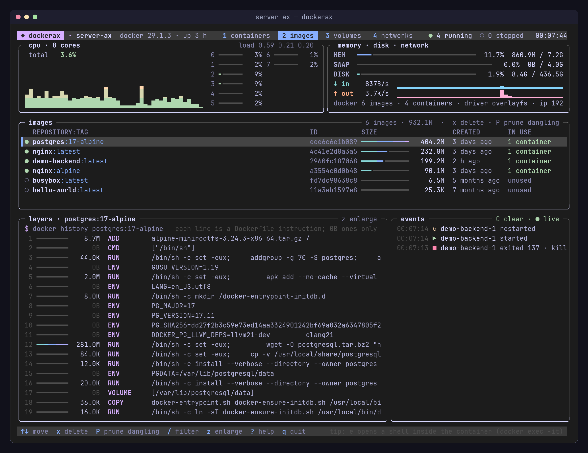
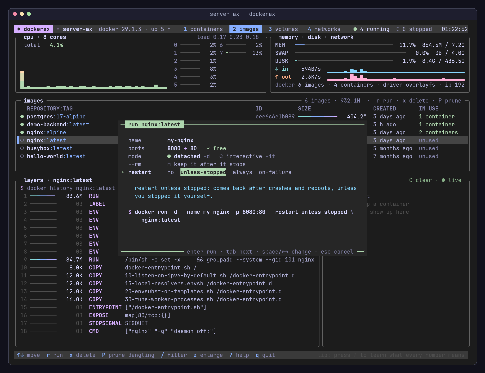
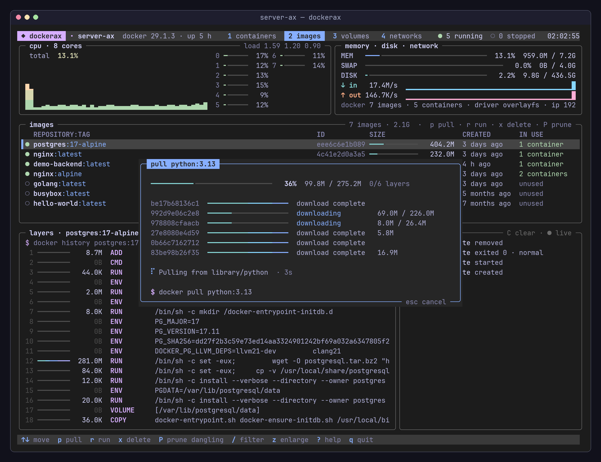
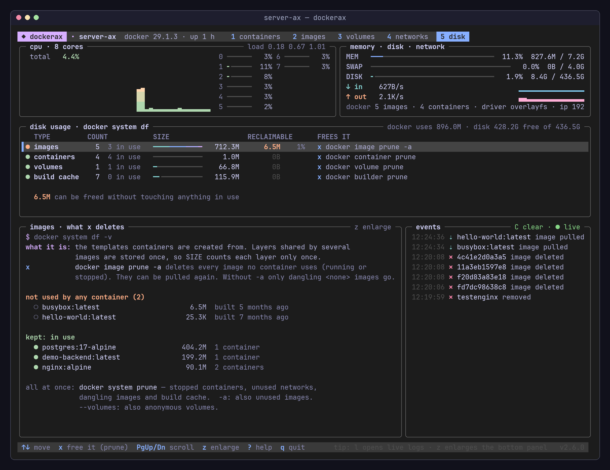
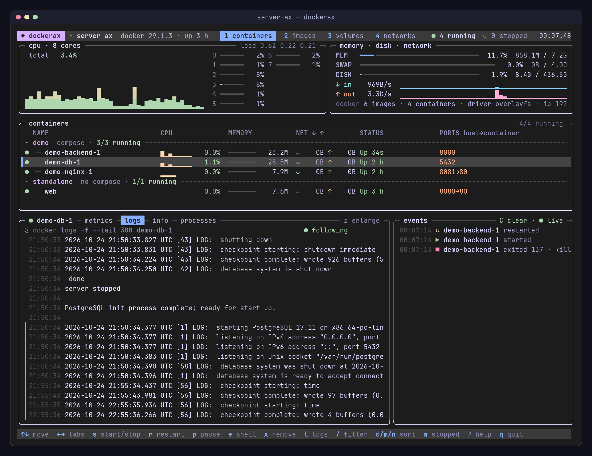

# dockerax

[](https://github.com/eduardo-ax/dockerax/actions/workflows/ci.yml) [](https://github.com/eduardo-ax/dockerax/releases/latest)

A Docker dashboard for the terminal — live, visual and didactic.



dockerax shows what is running on a Docker host and *explains* it while you use it: every action prints the equivalent `docker` command, ports are described as "host → container", exit codes are translated ("exited 137 · killed"), and a help screen explains what each number means. Good for running a home server, and good for learning Docker.

It is a **single Python file with no dependencies** (standard library only). It talks straight to the Docker Engine API over `/var/run/docker.sock` — no `docker` CLI calls, no pip install.

## Install

You need Linux, Python 3.8+ and access to the Docker socket (see [Requirements](#requirements)).

```bash
mkdir -p ~/.local/bin
curl -fsSL https://raw.githubusercontent.com/eduardo-ax/dockerax/main/dockerax.py -o ~/.local/bin/dockerax
chmod +x ~/.local/bin/dockerax
dockerax
```

If `dockerax` is not found, `~/.local/bin` is not in your `PATH` — add `export PATH="$HOME/.local/bin:$PATH"` to `~/.bashrc`, or run it as `~/.local/bin/dockerax`.

To install for every user on the machine:

```bash
sudo curl -fsSL https://raw.githubusercontent.com/eduardo-ax/dockerax/main/dockerax.py -o /usr/local/bin/dockerax
sudo chmod +x /usr/local/bin/dockerax
```

Or clone it:

```bash
git clone https://github.com/eduardo-ax/dockerax.git
cd dockerax
./dockerax.py
```

**On a remote server:** install it there the same way and open it over SSH with `ssh -t user@server dockerax` (`-t` gives it a terminal).

**Version:** `dockerax --version` (also in the bottom-right corner). **Update:** `dockerax --update` downloads the [latest release](https://github.com/eduardo-ax/dockerax/releases/latest) over the installed file (`sudo dockerax --update` if you installed it for every user); `dockerax --check` only tells whether there's a new one. Versions before 2.3.0 don't have `--update`: run the same `curl` command again once. **Uninstall:** `rm ~/.local/bin/dockerax ~/.config/dockerax.json`.

## Screenshots

**Networks** — a map of each network: which containers are on it, their IPs, the *public* ports (with a ready-to-open URL) and the *internal* address other containers use (`backend:8000`).



**Compose projects** — select a project row (`▾ demo`) to act on the whole project: stop/start, restart, pause, `down` and `up -d`. Services start in `depends_on` order and stop in reverse, like `docker compose` does.



**Images** — sizes, which ones are in use, and the layers of the selected image (each Dockerfile instruction with its size).



**Run** — press `r` on an image: pick a name, ports, detached or interactive, `--rm` and a restart policy. Every field explains its flag and the `docker run` command builds itself as you type.



**Pull** — press `p` and type an image name: live progress for every layer, `Esc` cancels, and `r` runs it when it's done.



**Disk** — what Docker takes on the disk (`docker system df`): images, containers, volumes and build cache, how much can be freed without touching anything in use, and exactly what each `x` (prune) would delete.



**Logs** — live `docker logs -f` of the selected container, with stderr marked and levels colored. `f` finds text (only matching lines, highlighted), `w` shows only warnings/errors, and the matching `docker logs … 2>&1 | grep` command is shown.



All screenshots show the [demo stack](#try-it-with-the-demo-stack) included in this repo: `nginx → backend → postgres`.

## Features

- **Host panel** — total CPU graph, per-core bars, load average, memory, swap, disk (of Docker's root dir) and host network traffic.
- **Containers** — grouped by compose project as a tree; CPU sparkline, memory bar, network rates, status and ports per row; animated state icons (unhealthy blinks, restarting spins).
- **Bottom panel tabs** for the selected container:
  - **metrics** — CPU, memory and network (in/out mirrored) history graphs with a value axis, grid lines, the peak reached, reference lines (1 core, memory limit) and a time axis.
  - **logs** — live `docker logs -f`, stderr marked in red, log levels and HTTP status codes colored, scrollback. **Find** (`f`) keeps only the lines with that text and highlights it, still live; `w` cycles all → warnings and errors → errors; `H` searches the last 3000 lines instead of 300. The equivalent `docker logs … 2>&1 | grep -i …` is shown above the lines.
  - **info** — restart policy, command, health, ports explained in plain words with a URL, networks with IPs, mounts, env vars (secrets masked) and an approximate `docker run` command that would recreate it.
  - **processes** — `docker top`, sorted by CPU.
- **Compose projects** — select the project row to see its services in start order (from `depends_on`), what each one needs, totals and CPU/memory graphs for the whole project, the compose file, networks and volumes. `s` stops/starts everything in dependency order (waiting for `service_healthy` dependencies), `r` restarts, `p` pauses, `x` is `docker compose down` (containers and networks removed, volumes kept) and `u` is `docker compose up -d` (re-reads the compose file — also brings back a project you took down).
- **Images** — size bars, in-use count, dangling images and image **layers**.
- **Pull images** (`p` in the images view) — type a name like `nginx:alpine`; it shows how the name breaks down (registry, user, name, tag — no tag means `latest`) and then live progress per layer, including layers that *already exist* because another image shares them. `Esc` cancels; when it finishes, `r` runs it.
- **Run a container from an image** (`r` in the images view) — a small form: name, host → container port (suggested from the image's `EXPOSE`, with a check that the host port is free), detached (`-d`) or interactive (`-it`), `--rm` and restart policy. Each field explains its flag, and the matching `docker run` command updates as you type.
- **Volumes** — size, which containers mount each volume and where.
- **Disk** (`5`) — `docker system df` as a table: size and reclaimable space of images, containers, volumes and build cache, plus the docker total and free disk. The panel below lists what `x` would delete and what is kept (in use). `x` runs the matching prune after a confirmation and says how much was freed: `docker image prune -a`, `docker container prune`, `docker volume prune` (unused **anonymous** volumes only — named volumes are deleted one by one in the volumes view) and `docker builder prune`.
- **Networks** — subnet, gateway and the **network map** described above.
- **Live events** — Docker's event stream described in words.
- **Actions** — pull images, run a container from an image, start/stop (also whole compose projects), restart, pause, remove, open a shell inside a container, delete images/volumes/networks, prune dangling images. Destructive actions ask for confirmation (`y`), and every action shows the equivalent `docker` command.
- **Mouse** — click rows, tabs and views; the wheel scrolls.
- Solid or transparent background, block or braille graphs — both remembered between runs.

## Requirements

- **Linux** with Docker Engine (host stats come from `/proc`).
- **Python 3.8+** — already installed on most distros. Only the standard library is used, including `curses`; on **openSUSE** that one is a separate package: `sudo zypper install python3-curses`.
- **Tested on** (CI, with each distro's own `python3`): Ubuntu 20.04, 22.04, 24.04 and 26.04 · Debian 12 and 13 · Fedora · Arch Linux · Alpine · openSUSE Tumbleweed — plus Python 3.8 to 3.14 and a smoke test of the dashboard against a real Docker.
- Access to the Docker socket: be root or a member of the `docker` group (`sudo usermod -aG docker $USER`, then log out and back in). Set `DOCKER_SOCK` to use another socket path.
- A **256-color terminal** (`TERM=xterm-256color` or similar) and a font with box-drawing and braille characters (any modern monospace font).
- The `docker` CLI only for the **e** key (shell inside a container) and **u** (`docker compose up -d`, which needs the compose file).

## Keys

| Key | Action |
|---|---|
| `1` `2` `3` `4` `5` | containers · images · volumes · networks · disk |
| `↑` `↓` / `j` `k` | select |
| `←` `→` / `Tab` | switch the bottom tab (containers) or the view |
| `PgUp` `PgDn` | scroll logs / info / processes |
| `End` / `G` | resume following logs |
| `f` | find in logs: only lines with that text (`Esc` clears) |
| `w` | logs: all → warnings and errors → errors only |
| `H` | logs: last 3000 lines instead of 300 |
| `s` | start / stop (on a compose project row: the whole project) |
| `r` | restart |
| `p` | pause / resume |
| `x` | remove (stopped container, image, volume, network) · `docker compose down` on a project row · prune in the disk view |
| `u` | `docker compose up -d` (on a project row) |
| `p` (images view) | pull an image (`docker pull`) |
| `r` (images view) | run a container from the selected image |
| `P` | prune dangling images (images view) |
| `e` | open a shell in the container (`docker exec -it … sh`) |
| `l` `i` `t` | logs / info / processes tab |
| `z` | enlarge the bottom panel (`Esc` goes back) |
| `/` | filter by name |
| `c` `m` `n` | sort by CPU / memory / name |
| `a` | show / hide stopped containers |
| `C` | clear the events panel |
| `b` | solid / transparent background |
| `g` | block / braille graphs |
| `?` | help: shortcuts and what the numbers mean |
| `q` | quit |

## Try it with the demo stack

[`examples/demo-stack`](examples/demo-stack) is a small compose project to explore the views: `nginx (port 8081) → backend (Python) → postgres`. The database sits on an `internal` network that nginx cannot reach — open the networks view (`4`) and compare `demo_web` with `demo_data`.

```bash
git clone https://github.com/eduardo-ax/dockerax.git
cd dockerax/examples/demo-stack
docker compose up -d --build      # http://<host>:8081 returns JSON with a visit counter
dockerax                          # or ../../dockerax.py
docker compose down -v            # remove everything, including the database volume
```

## Configuration

Preferences are saved in `~/.config/dockerax.json`:

```json
{"solid": true, "graph": "blocks", "events_cleared": 1792877087}
```

- `solid` — paint dockerax's own background instead of the terminal's (`b`).
- `graph` — `"blocks"` or `"braille"` (`g`).
- `events_cleared` — Unix time of the last `C`. Docker keeps its event history in memory and dockerax normally asks for the last 6 hours; after a clear it only asks for newer events. Nothing is deleted from Docker.

Constants at the top of `dockerax.py`: `INTERVAL` (seconds between polls, default 2), `HIST` (graph history samples), `FPS` (redraw rate) and the color palette (Catppuccin Mocha).

## How it works

- **Collector thread** — every 2 s reads `/proc` (CPU, memory, network) and asks Docker for the container list and a one-shot stats sample per running container, in parallel. CPU % and network rates come from deltas between polls, so it stays light.
- **Event feed thread** — keeps a streaming connection to `/events`; every event is described, shown, and wakes the collector so the screen updates immediately.
- **Log tail thread** — streams `/containers/{id}/logs?follow=1` for the selected container only while the logs tab is open, demultiplexing stdout/stderr frames.
- **Cache** — inspect, top, images, volumes, networks and image history are fetched in the background with an expiry, so drawing never waits on Docker.
- **UI** — curses, redrawn 10× per second; colors are RGB converted to the 256-color palette; values ease towards their target for smooth animation.

## Troubleshooting

- **`no access to /var/run/docker.sock`** — add your user to the `docker` group (`sudo usermod -aG docker $USER`) and log in again.
- **Colors look wrong / no background** — check `echo $TERM`; it should be a 256-color terminal. Over SSH use `ssh -t`.
- **Broken characters** — use a UTF-8 locale and a font with box-drawing and braille glyphs.
- **An old version opens** — run `hash -r` or open a new shell; `type dockerax` shows which file runs.

## Similar tools

[lazydocker](https://github.com/jesseduffield/lazydocker), [ctop](https://github.com/bcicen/ctop) and [oxker](https://github.com/mrjackwills/oxker) are great terminal UIs for Docker too. dockerax focuses on *showing and explaining*: every action prints the equivalent `docker` command, and views like the network map, the compose start order and disk usage explain what Docker is doing — all in a single Python file with no dependencies.

## License

[MIT](LICENSE)
